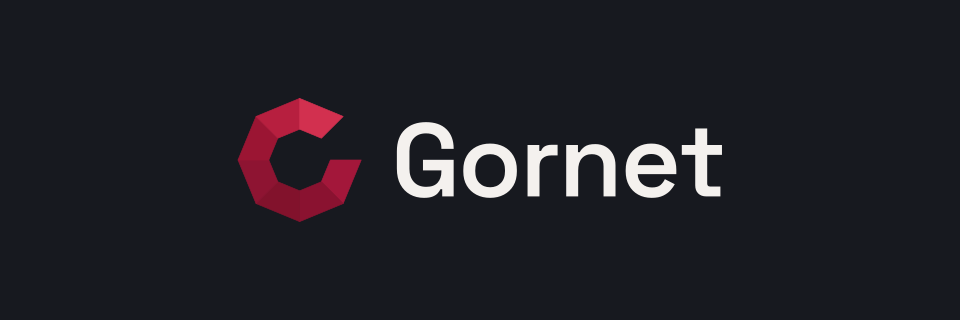

> Проект в разработке. Ниже — первичный концепт.

**Gornet** — расширяемая self-hosted client-server платформа на Go для выполнения операций через собственный CLI.

Платформа состоит из двух основных компонентов:

- **Server** — серверная часть, предоставляющая RPC API на основе gRPC.
- **CLI** — клиентская утилита для взаимодействия с сервером и выполнения доступных операций.

## Архитектура

В основе платформы лежит разделение на независимое ядро (Core) и модули, расширяющие его функциональность.

**Core** предоставляет общие механизмы платформы:
- Аутентификация и авторизация.
- Управление конфигурацией.
- Аудит операций.
- Регистрация и управление сервисами.
- Выполнение и отслеживание длительных задач.

**Модули** реализуют конкретную функциональность и интегрируются с Core. Они расширяют возможности Server и CLI, не требуя изменения основного ядра. Модули статически подключаются при сборке приложения.

## Работа с несколькими серверами

Можно одновременно запускать несколько независимых экземпляров Server, например, в разных окружениях или на разных узлах инфраструктуры.

CLI поддерживает именованные профили подключений, позволяя переключаться между серверами без необходимости каждый раз указывать параметры подключения.

## Возможности применения

Gornet не привязан к конкретной предметной области. Платформа предназначена для создания и предоставления собственных операций через единый API и CLI.

Возможные направления применения:
- Управление серверами и инфраструктурой.
- Автоматизация административных задач.
- Интеграция со сторонними сервисами и API.
- Создание собственных инструментов и приложений.